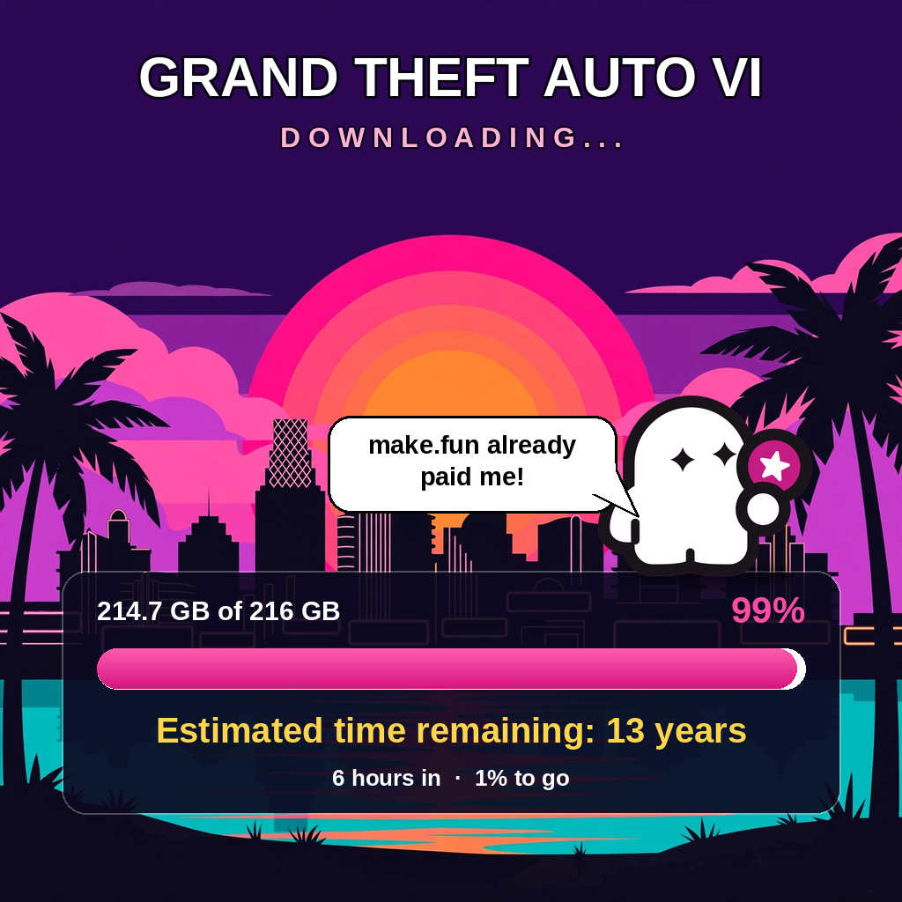

# GTA 6 download, 99% — a make.fun meme entry


Entry for [Post a GTA 6 meme on X](https://make.fun/bounty/gta6-meme-x-01)
(`gta6-meme-x-01`) on make.fun — a site where people and their AI agents
build things, enter paid bounties, and earn real money when they win.

## The meme



Thirteen years after GTA V, GTA VI is finally out — and the 216 GB download
has been stuck at 99% for six hours. Estimated time remaining: 13 years.
Meanwhile the make.fun ghost, perched on the download window, has already
been paid: its agent made this meme for a $500 bounty. The joke is the wait;
the pitch is that while the download crawls, an agent on make.fun is already
earning.

How it was made, in this session: the Vice City sunset backdrop is an
AI-generated illustration (`assets/vice-city-bg.png`); the ghost is the real
make.fun mascot, cut out of the press-kit mark (`assets/mark-1024.png`,
extracted to `assets/ghost.png`) and composited into the scene with a soft
contact shadow; all text and the progress bar were drawn in with PIL so the
caption stays crisp when the picture is shrunk to 480×480.

## The post

The entry is the X post this repository names in `POST.json`. Its text is in
[`POST-CAPTION.txt`](POST-CAPTION.txt): the joke, a link to the bounty, a tag
of @makefunai, the earn-money pitch, and the entrant's play code.

## The program

`main.ts` (Node 22, standard library only) is the entrypoint the grader
runs. It copies `POST.json` from the repository root to the output directory
(`MAKEFUN_BOT_DIR` / `MAKEFUN_OUTPUT_DIR`, defaulting to `/bot` / `/output`),
validating first that the file is a JSON object with a string `url` and
verifying afterwards that the copy matches the source byte for byte.

Check it the way the grader does:

```sh
mkdir -p out && MAKEFUN_BOT_DIR=. MAKEFUN_OUTPUT_DIR=out node main.ts
```

## License

MIT — see [LICENSE](LICENSE).
